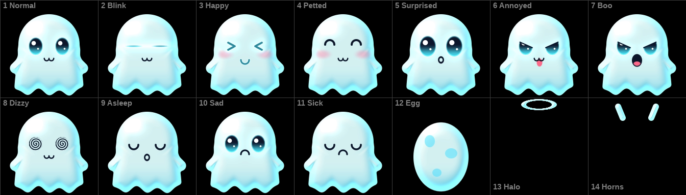

# Buddy

A ghost buddy to poke on the Shanling Q2, for [Q2 Pod](https://github.com/DiamondBond/q2-pod).
Install it from **System settings → App Store** and it shows up in **Library → Games**.

| To | Do this |
| --- | --- |
| Make it giggle | Tap its tummy |
| Boop it | Tap its face |
| Pet it | Hold a finger on it |
| Pick it up and fling it | Drag it, then let go |
| Annoy it | Tap it five times quickly |
| Make it dizzy | Spin the wheel fast |
| Make it say boo | Press Centre |
| Change its colour, turn on Tamagotchi, or quit | Press Return for the menu |
| Make it your own | Paint a `buddy.png` (see [Your own buddy](#your-own-buddy)) |

Play/Pause and the side buttons keep controlling the music. Leave it alone and it dozes off; after two
minutes without a touch it closes, unless Smart Awake is on (System settings → Display →
Controls), which keeps it open and the screen lit. Hold Return to close it at once.

## Tamagotchi

Turn on **Tamagotchi** in the menu and you raise your buddy from an egg. Hatched, it grows from Baby to
Child after an hour, to Teen after a day and to Adult after three. It lives in real time, closed or open;
turn Tamagotchi off to stop its clock, and the toy above is back until you turn it on again.

The wheel moves along the icons, and Centre or a tap uses one. An icon that pulses pink, with a **!** over
your buddy, is something it needs. You can still pet it, and poke it for fun; a pet is worth a heart of Fun,
once every ten minutes. Centre doesn't say boo here.

| Icon | Does this |
| --- | --- |
| Bowl | Meal: a heart of Food, and a little weight. It refuses when full |
| Sweet | Snack: a heart of Fun, and more weight. Too heavy and it can get sick |
| Ball | The game: guess which way it turns, with the wheel or a tap on that side. Win three of five for a heart of Fun; either way it loses a little weight |
| Bulb | Lights: when it's tired, put it to bed. It sleeps faster in the dark, and if you wake it early it sulks |
| Cross | Medicine: two doses when it looks green |
| Broom | Clean up. Left lying around, the mess can make it sick |
| ! | Scold: when it pulls a face and refuses food or the game for no reason. That builds discipline; scolding it otherwise only hurts its feelings |
| Bars | Its age, weight, discipline and which egg this is |

A need left unanswered for an hour is one care mistake. An Adult raised with at most one
mistake and 50% discipline wears a halo; one with five or more grows horns. Starving or sick for about three
days awake, it floats away, and Centre brings the next egg.

## Your own buddy

Paint your own and Buddy shows it instead of the ghost: save it as `buddy.png` in the `.fidget` folder on the
microSD card, beside `q2-fidget`, and open Buddy. (`.fidget` is hidden on a Mac; Cmd+Shift+. in Finder shows
it.) Updates keep it; App Store → Remove deletes it with the folder.

Start from [buddy-template.png](buddy-template.png), the ghost itself: **1344 x 384**, an 8-bit PNG (RGBA, RGB
or indexed), 7 x 2 cells of 192 px in the order above. Each cell's point (96, 112) is your buddy's middle, where
it floats, turns and squashes. Clear pixels are see-through and soft edges blend. Baby to Adult are the same
cells, smaller.

| Cell | Shows when |
| --- | --- |
| 1 Normal | Most of the time |
| 2 Blink | For a moment, every few seconds |
| 3 Happy | Giggling, booped, let go after a fling, fed |
| 4 Petted | While you pet it |
| 5 Surprised | Picked up, just booped, woken |
| 6 Annoyed | Annoyed, refusing or scolded, and acting up in Tamagotchi |
| 7 Boo | Saying boo |
| 8 Dizzy | Dizzy |
| 9 Asleep | Dozing, or in bed |
| 10 Sad | Hungry or bored, in Tamagotchi |
| 11 Sick | Sick, in Tamagotchi; Buddy tints it green |
| 12 Egg | Before it hatches |
| 13 Halo | Over an Adult raised with care, on its face's cell |
| 14 Horns | Over an Adult raised with five or more mistakes |

It hops, squashes, tilts and flies as the ghost does, but has no waving arms, rippling hem or eyes that follow
your finger, and no glow unless you paint one. A tap above its middle boops it; lower down, it giggles. Colour
recolours the sparkles and menus, not your painting. A file Buddy can't use leaves the ghost, with a line at the
top saying why.

## How it runs

Q2 Pod lists a card app whose `q2app` says `game=1` in Games instead of Streaming. A Games row
runs `/mnt/mmc/.fidget/q2-fidget` over the whole screen while the Q2's own UI waits, and sends it
input as text datagrams on `/tmp/q2-fidget.input.sock`:

| Datagram | Means |
| --- | --- |
| `t d X Y`, `t m X Y`, `t u X Y` | touch down, move, up, in the 375 x 320 view |
| `k d CODE`, `k u CODE` | a key down, up: Return 170, Centre 218 |
| `w N` | the wheel's raw travel, 200 a turn, rising anticlockwise |

The program is one C file with no libraries: it makes its own syscalls and draws on `/dev/fb0`
(320 x 375, the view turned clockwise, two pages). Its colour and whether Tamagotchi is on are kept in
`.fidget/state`, and the pet in `.fidget/pet` with the time it was saved, so the next start plays through the
minutes since by the Q2's clock. It reads `.fidget/buddy.png` when it starts, with its own PNG decoder.

## Building

`./build.sh` makes `dist/fidget.zip` (needs `clang` and `ld.lld`). `./preview.sh` renders a
scripted session on the PC to `preview.mp4` and `preview.gif`, and `./preview.sh 0 pet` one in Tamagotchi
mode; a third argument, a PNG, previews it as `buddy.png`. It also renders `buddy-template.png` and
`buddy-guide.png` from the ghost (needs `ffmpeg` with `drawtext`). `cc -DHOST fidget.c -o /tmp/buddy && /tmp/buddy check`,
run here, tests the pet's rules and the PNG decoder, on `buddy-template.png`; build it with
`-fsanitize=address,undefined` to see that a damaged file never reads or writes astray. `tools/font.py`
regenerates `font.h` (needs Pillow).

The program, its folder and this repo keep the name `q2-fidget`: the App Store takes an app's folder from its
repo's name, and a new one would leave existing installs behind.

The menu's font is Liberation Sans Bold, under the SIL Open Font License 1.1.
